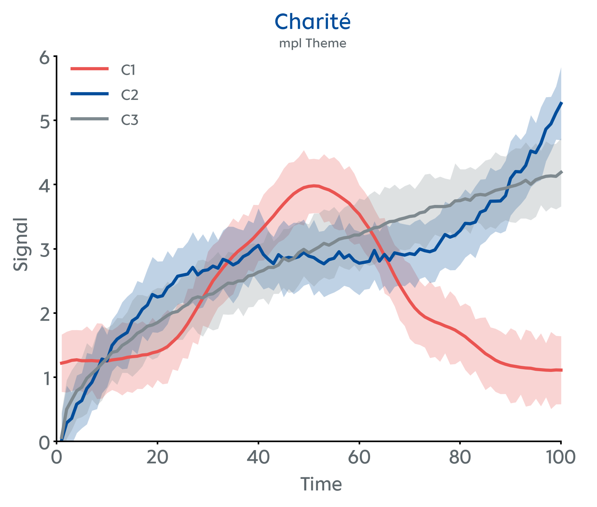
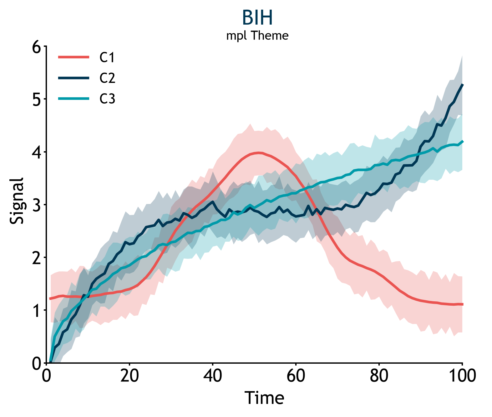
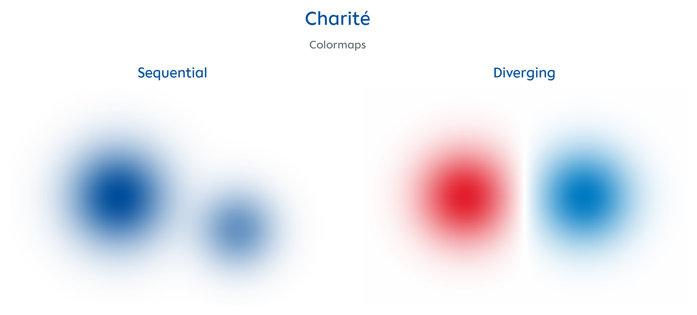
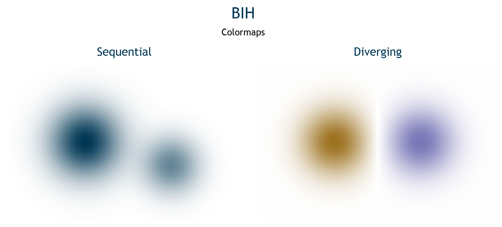
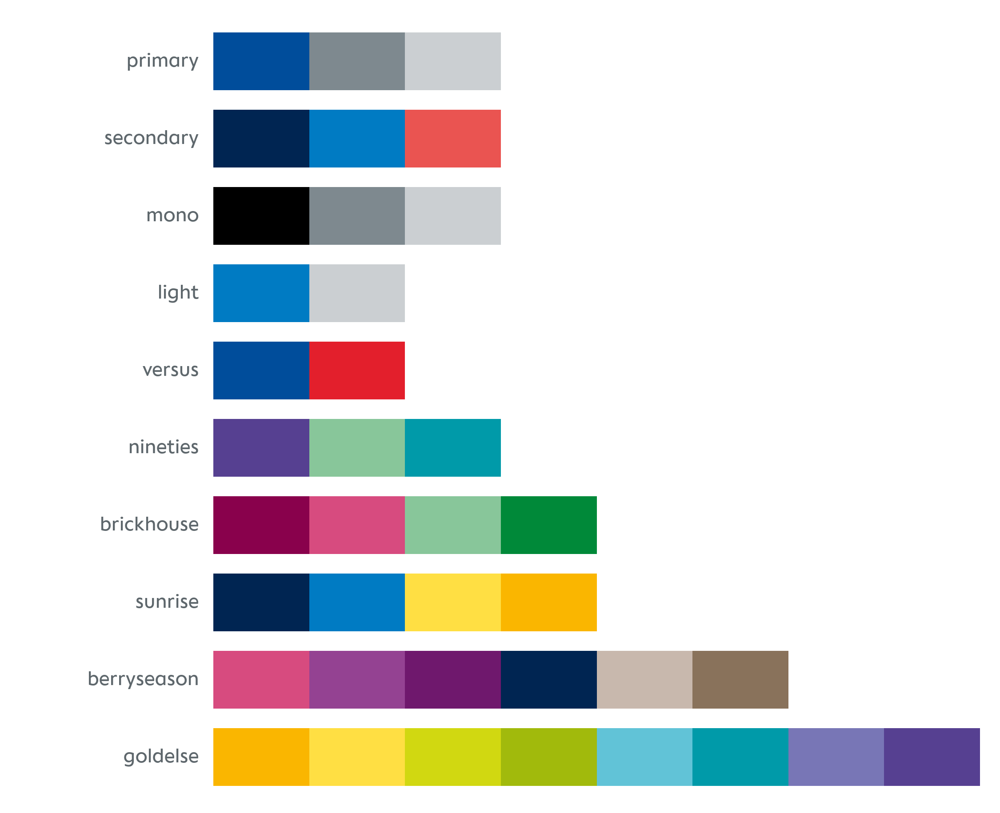
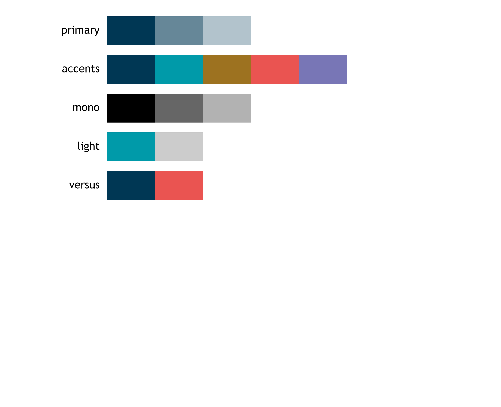
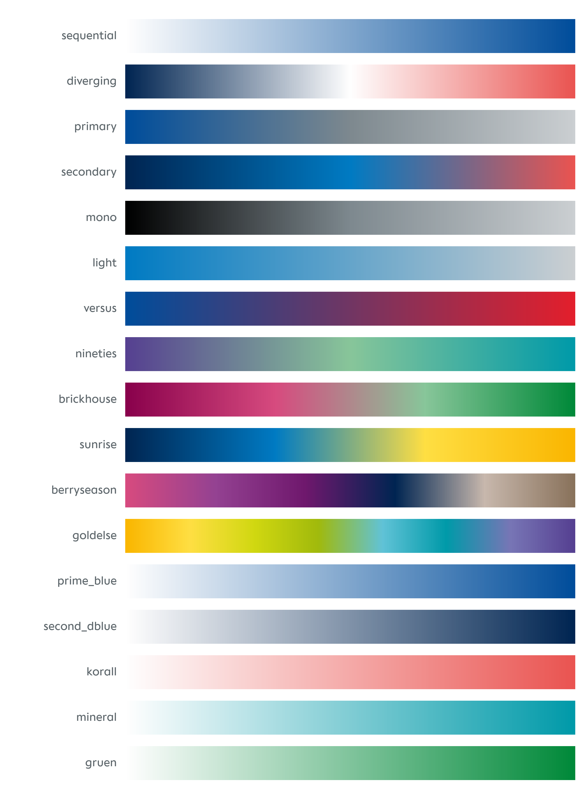
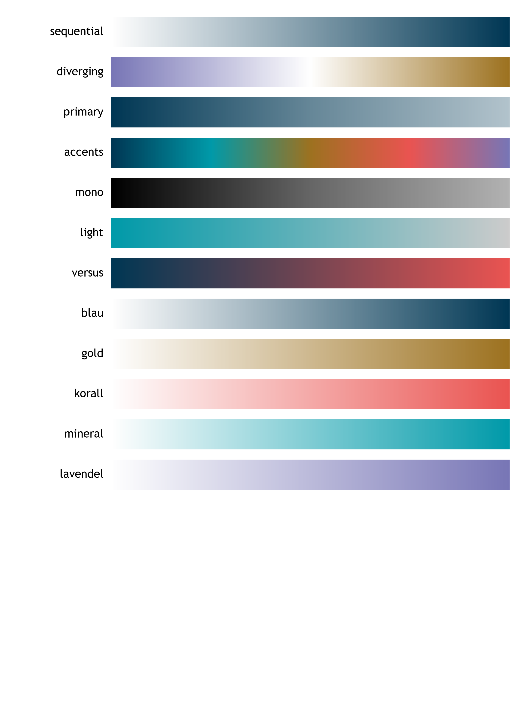

# charite-plot


A Python package with Matplotlib and Altair themes and [visual identity](https://marke.charite.de/d/Y3FxSwD6Tz3a) colour palettes for Charité – Universitätsmedizin Berlin and the Berlin Institute of Health at Charité (BIH) — ported from the [`charite` R package](https://github.com/johannesjuliusm/charite).

## Installation

```bash
pip install charite-plot                   # Matplotlib only
pip install "charite-plot[altair]"         # with Altair support
```

## Examples

Visualize your data with `theme_charite()` or `theme_bih()` to match the Charité or BIH corporate style.

<table>
<tr><th>Charité</th><th>BIH</th></tr>
<tr>
<td></td>
<td></td>
</tr>
</table>

Heatmaps use the brand's sequential colormap by default; `make_cmap("diverging")` gives the diverging one.

<table>
<tr><th>Charité</th><th>BIH</th></tr>
<tr>
<td></td>
<td></td>
</tr>
</table>

Preview the available colour palettes of each brand.

<table>
<tr><th>Charité</th><th>BIH</th></tr>
<tr>
<td></td>
<td></td>
</tr>
</table>

Continuous colormaps (`make_cmap`): each brand's sequential and diverging scale, every palette, and white → colour.

<table>
<tr><th>Charité</th><th>BIH</th></tr>
<tr>
<td></td>
<td></td>
</tr>
</table>

## Quick start

### Matplotlib

```python
import matplotlib.pyplot as plt
from charite_plot.mpl_themes import enable

enable()

fig, ax = plt.subplots()
ax.plot([1, 2, 3], [4, 7, 3])
ax.set_title("My chart")
plt.show()
```

Use as a context manager to scope the theme to a single figure:

```python
from charite_plot.mpl_themes import using

with using(palette="goldelse"):
    fig, ax = plt.subplots()
    ax.bar(["A", "B", "C"], [3, 7, 5])
```

### Altair

```python
from charite_plot.altair_themes import enable
import altair as alt

enable()

chart = alt.Chart(df).mark_bar().encode(...)
```

Customise with keyword arguments:

```python
enable(palette="berryseason", font_size=13)
```

### BIH

Every function takes a keyword-only `brand` argument (default `"charite"`):

```python
from charite_plot import mpl_themes, altair_themes

mpl_themes.enable(brand="bih")
altair_themes.enable(brand="bih", palette="versus")
params = mpl_themes.theme_bih(font_size=8)  # = mpl_themes.theme(font_size=8, brand="bih")
```

The BIH theme follows the BIH brand handbook (colours, Trebuchet MS, tints in 10 % steps) with one
deliberate deviation: text and axes are **black** instead of BIH-Blau, as expected by scientific journals.
Titles stay BIH-Blau.

### Continuous colormaps

```python
from charite_plot import make_cmap, make_ramp

ax.imshow(data, cmap=make_cmap("prime_blue"))  # white → Charité blue, like "Blues"
ax.scatter(x, y, c=z, cmap=make_cmap("goldelse"))  # through a whole palette
alt.Scale(range=make_ramp("blau", brand="bih"), interpolate="rgb")  # same gradient in Altair
```

## API overview

| Symbol | Description |
|--------|-------------|
| `mpl_themes.theme(**kwargs, brand="charite")` | Returns a matplotlib rcParams dict for a brand theme (`theme_charite` / `theme_bih` = `theme` with `brand="charite"` / `"bih"`) |
| `mpl_themes.enable(**kwargs)` | Applies the theme permanently to `rcParams` |
| `mpl_themes.using(**kwargs)` | Context manager: applies the theme temporarily |
| `altair_themes.theme(**kwargs, brand="charite")` | Returns a Vega-Lite config dict for a brand theme (`theme_charite` / `theme_bih` = `theme` with `brand="charite"` / `"bih"`) |
| `altair_themes.enable(**kwargs)` | Registers and enables the theme in Altair |
| `altair_themes.using(**kwargs)` | Context manager: enables the theme temporarily |
| `altair_themes.register()` | Registers the theme without enabling it (Altair-only) |
| `PALETTES` | Dict of the 10 named Charité colour palettes (BIH: `BIH.palettes`) |
| `make_palette(name, n, reverse, brand)` | Subsample or interpolate any palette |
| `make_cmap(name, reverse, brand)` | Continuous matplotlib colormap through a palette, or white → one brand colour (like `"Blues"`) |
| `make_ramp(name, reverse, brand)` | The colour stops of that scale, e.g. for `alt.Scale(range=make_ramp(...), interpolate="rgb")` |
| `CHARITE`, `BIH` | The built-in brands (colours, palettes, fonts, colour roles) |
| `Brand`, `Roles`, `register_brand()`, `get_brand()`, `tint()` | Define and register further brands (see `charite_plot/brands/`) |
| `CHARITE_COLORS` | Dict of all 27 hex colour constants |

## Fonts

The Charité fallback chain follows the official Charité brand guidelines:

**Charité Text Office → Charit? Text Office → Calibri → DejaVu Sans → sans-serif**

For BIH, the brand handbook prescribes Trebuchet MS:

**Trebuchet MS → DejaVu Sans → sans-serif**

`DejaVu Sans` ships with Matplotlib and is always available as the penultimate fallback; `sans-serif` lets the browser or system choose if nothing else matches (important for Altair/Vega-Lite). To override the preferred font:

```python
enable(font="Arial")
```

## How to cite

If you use charite-plot in your work, please cite it as:

```bibtex
@software{ramezani2026chariteplot,
  author    = {Ramezani, Pedram},
  title     = {charite-plot: Matplotlib and Altair Themes for Charité – Universitätsmedizin Berlin},
  year      = {2026},
  version   = {0.3.0},
  url       = {https://github.com/pedramezani/charite-plot},
  license   = {MIT},
}
```

## Acknowledgements

This package is based on the original [`charite` R package](https://github.com/johannesjuliusm/charite) developed by Johannes Julius Mohn.

## License

MIT © 2026 Pedram Ramezani

The original `charite` R package by Johannes Julius Mohn is likewise MIT licensed.
