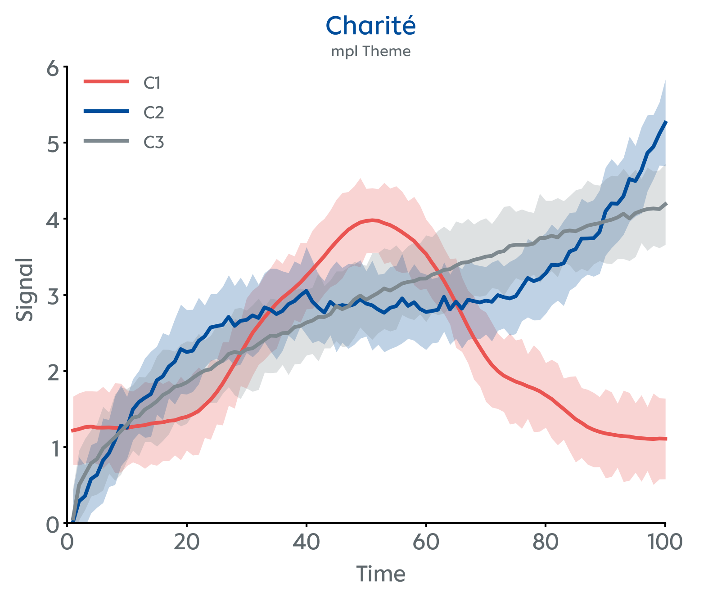
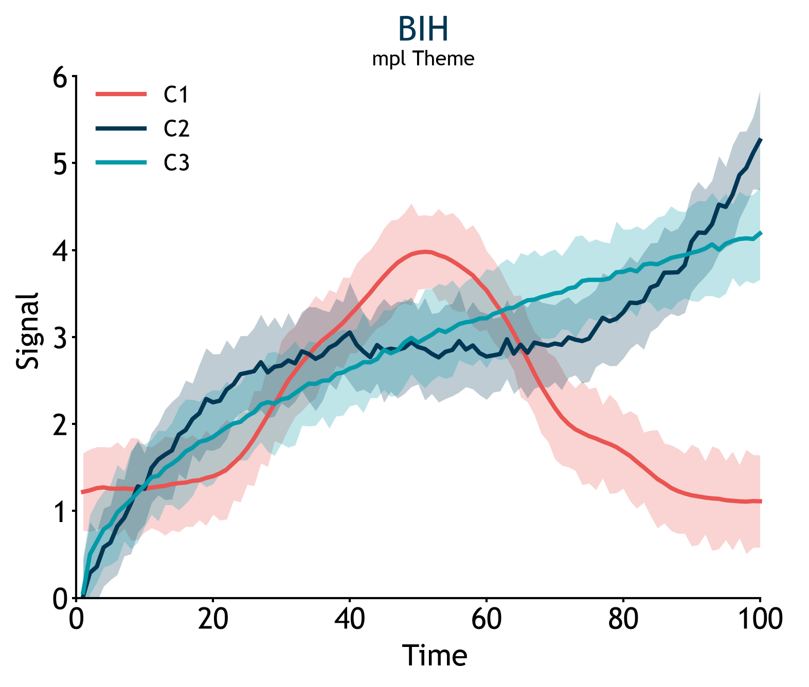
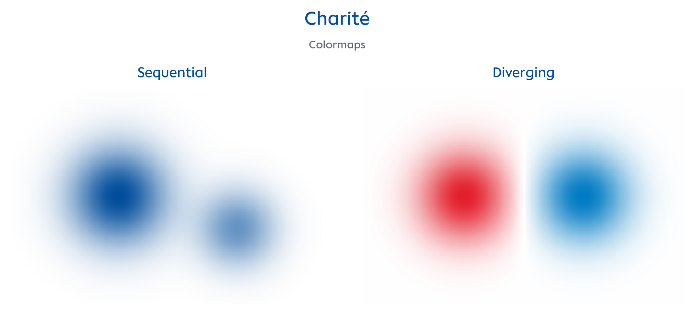
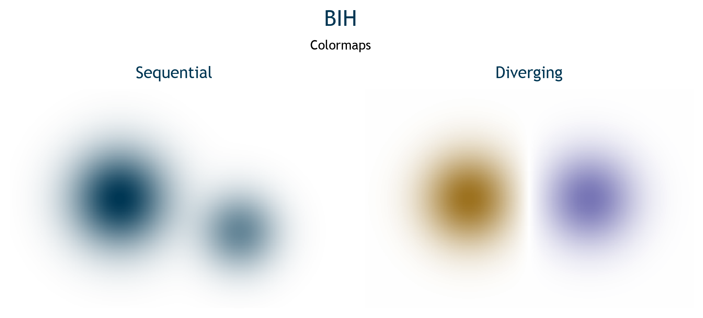
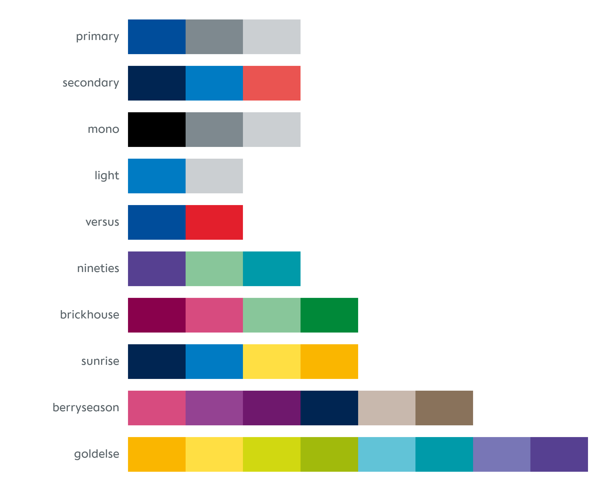
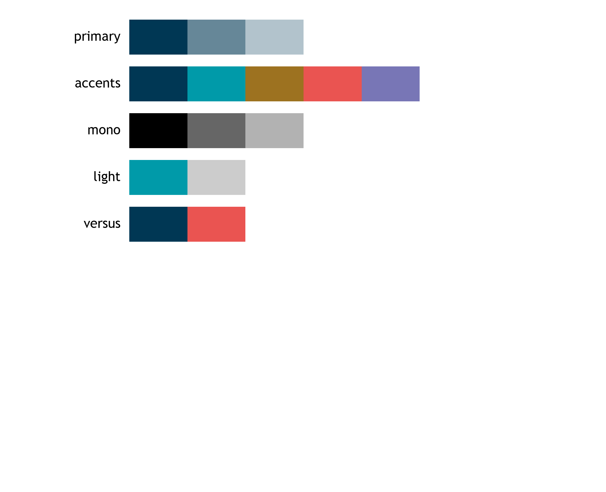
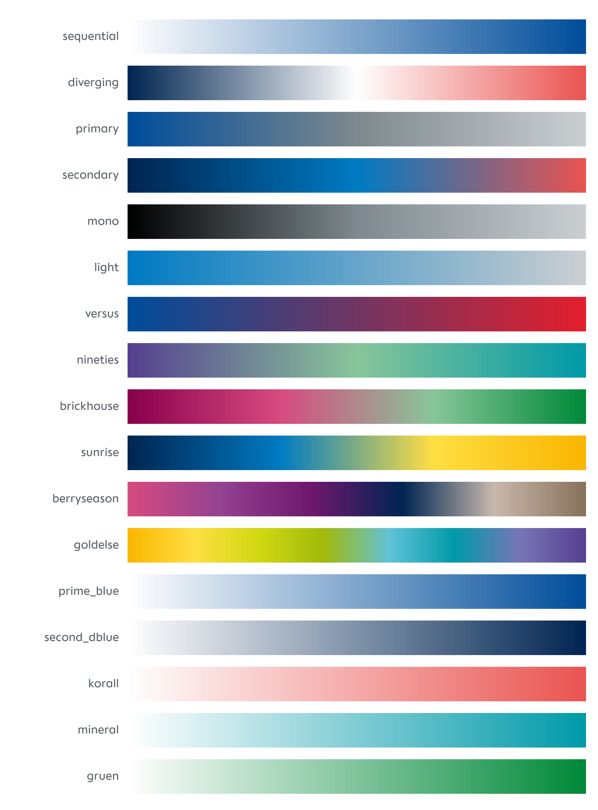
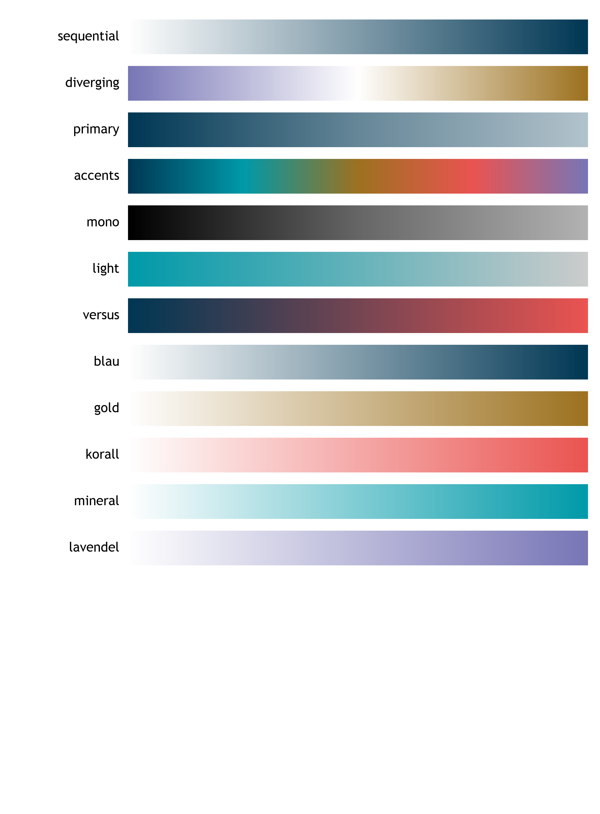

# charite-plot

A Python package with Matplotlib and Altair themes and [visual identity](https://marke.charite.de/d/Y3FxSwD6Tz3a) colour palettes for Charité – Universitätsmedizin Berlin and the Berlin Institute of Health at Charité (BIH) — ported from the [`charite` R package](https://github.com/johannesjuliusm/charite).

Visualize your data with `theme_charite()` or `theme_bih()` to match the Charité or BIH corporate style.

<table>
<tr><th>Charité</th><th>BIH</th></tr>
<tr>
<td></td>
<td></td>
</tr>
</table>

Heatmaps use the brand's sequential colormap by default; `make_cmap("diverging")` gives the diverging one.

<table>
<tr><th>Charité</th><th>BIH</th></tr>
<tr>
<td></td>
<td></td>
</tr>
</table>

Preview the available colour palettes of each brand.

<table>
<tr><th>Charité</th><th>BIH</th></tr>
<tr>
<td></td>
<td></td>
</tr>
</table>

Continuous colormaps (`make_cmap`): each brand's sequential and diverging scale, every palette, and white → colour.

<table>
<tr><th>Charité</th><th>BIH</th></tr>
<tr>
<td></td>
<td></td>
</tr>
</table>

---

## Quick start

### Matplotlib

```python
import matplotlib.pyplot as plt
from charite_plot.mpl_themes import enable

enable()

fig, ax = plt.subplots()
ax.plot([1, 2, 3], [4, 7, 3])
ax.set_title("My chart")
plt.show()
```

Use as a context manager to scope the theme to a single figure:

```python
from charite_plot.mpl_themes import using

with using(palette="goldelse"):
    fig, ax = plt.subplots()
    ax.bar(["A", "B", "C"], [3, 7, 5])
```

### Altair

```python
from charite_plot.altair_themes import enable
import altair as alt

enable()

chart = alt.Chart(df).mark_bar().encode(...)
```

---

## Design principles

- **Single source of truth** — every brand-specific value (colors, palettes, fonts, color roles) is defined once in `charite_plot/brands/` (`charite.py`, `bih.py`); the theme code is brand-agnostic.
- **No side effects on import** — theme functions return plain dicts; you opt in with `enable()` or `using()`.
- **Font fallback** — if Charité Text Office is not installed, the theme cascades to Charit? Text Office, then Calibri, DejaVu Sans, and finally sans-serif automatically, following the official brand guidelines. The BIH theme uses Trebuchet MS → DejaVu Sans → sans-serif.
